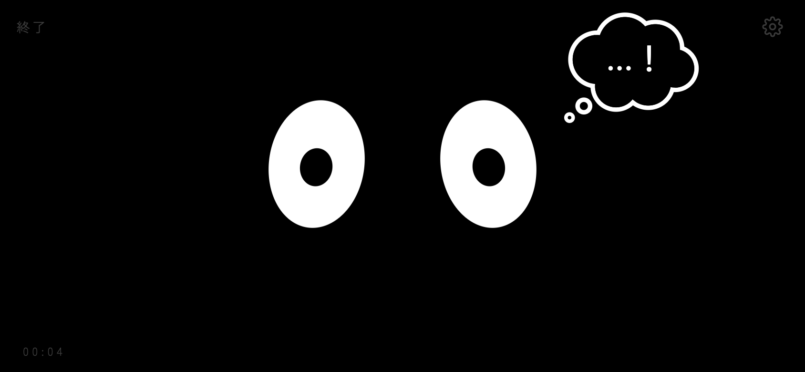
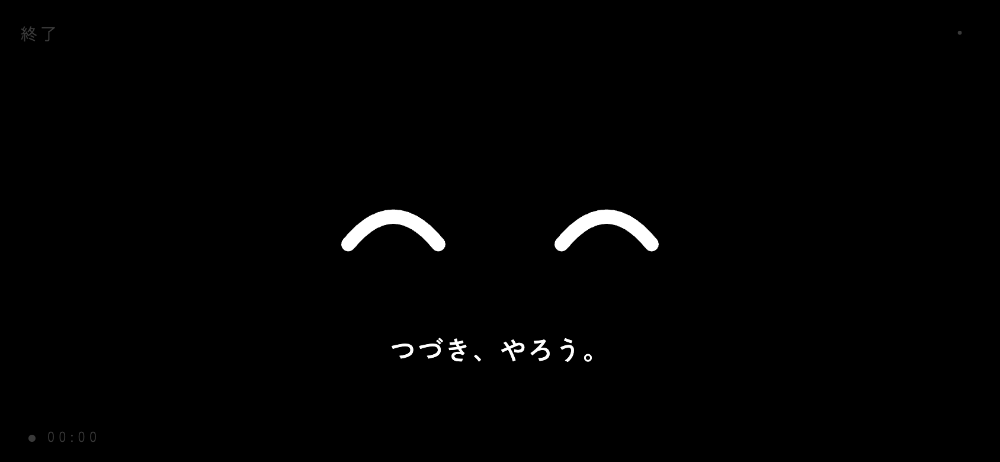
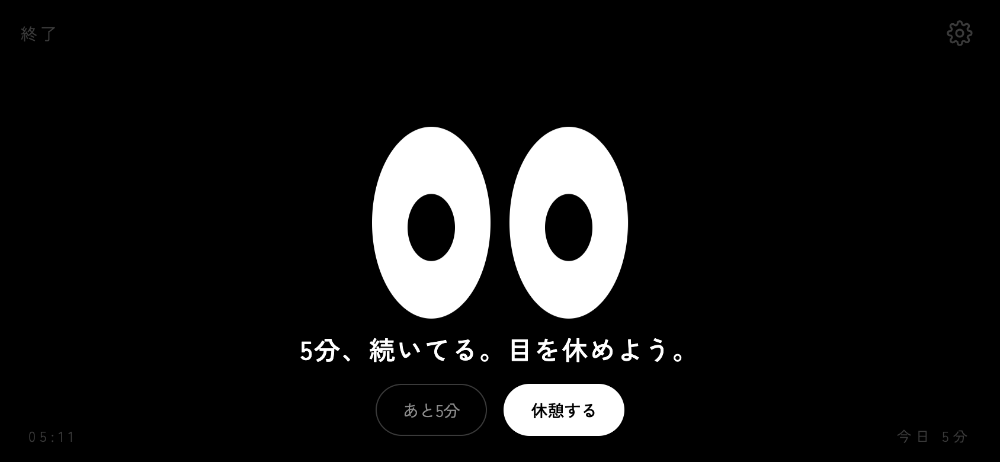
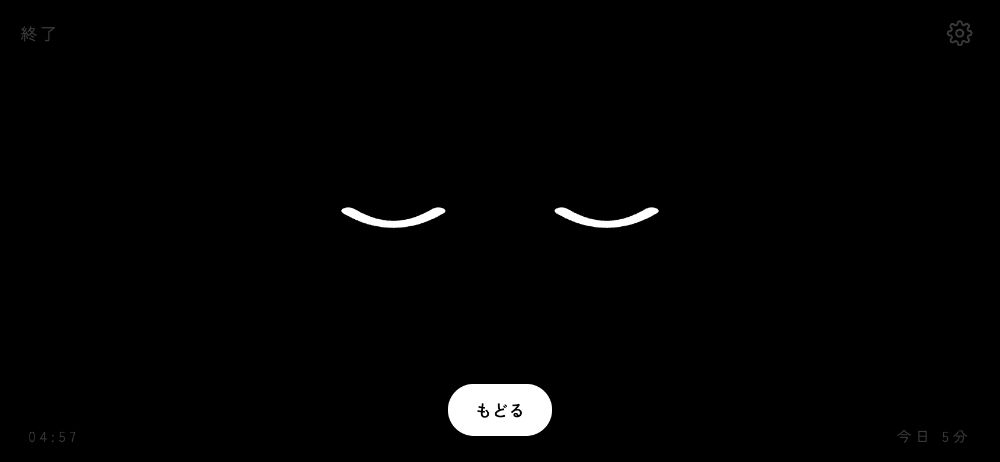
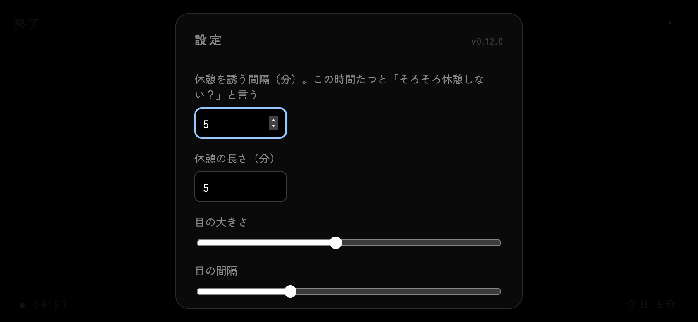

# め

黒い画面に、目だけ。勉強や作業のとなりに置いておく相棒。
スマホを横向きにして机の端に立てかける想定。

**→ https://kotta-27.github.io/me-buddy/**



## できること

| | |
|---|---|
|  | **はじめる**<br>計測開始。目が笑って一言。 |
|  | **休憩に誘う**<br>一定時間（既定 50 分、1 分から設定可）で「そろそろ休憩しない？」。あと5分 / 休憩する。 |
|  | **休憩**<br>目を閉じてカウントダウン。終わると「そろそろ、もどろうか」。 |
|  | **設定**<br>声かけ間隔、休憩の長さ、目の大きさ・間隔、独り言、画面を消さない。 |

- 目はまばたき・視線の泳ぎ・ゆらぎ。画面をなでると指を追う。タップでウインク
- 90 分を超えると半目になる
- ときどき独り言（「水、飲んだ？」など）。設定でオフ可
- 今日の合計時間は端末に保存（localStorage）
- 声かけを無視し続けると 3 分ごとにため息＋ひと言
- 60 / 120 / 180 分の節目で褒める
- 途中で閉じても 10 分以内に開けば続きから（それ以上は合計に足して終了）
- 設定: 目の明るさ、声かけ時の音（既定オフ）とバイブ（Android）
- PC: Space で開始 / 休憩 / 戻る
- 黒ベタなので OLED だとほぼ消灯。眩しくない

## しぐさ

待機中、ときどきどれか（直前と同じものは避ける。深夜・90分超は眠い系が増える）。頻度は設定「しぐさの多さ」で、多め 10〜30 秒 / ふつう 1 分前後 / 少なめ 2〜5 分。既定は多め。

| しぐさ | 目 |
|---|---|
| 考え事 | 斜め上を見て止まる → 雲の吹き出しに「・」「・・」「・・・」→ 瞳が小刻みに揺れる →「？」 |
| ウトウト→ハッ | まぶたがじわじわ降りる、途中で持ち直す → 閉じる直前に見開く |
| キョロキョロ | 左→右→左、最後に正面 |
| 二度見 | ちらっ → もう一度ガッと「！」 |
| ぼーっ | 瞳が広がって視線が漂う「…」 |
| 目をこする | ぎゅっと閉じて小刻みに揺れる（半分の確率でそのままウトウトへ） |
| ため息 | 一瞬だけ下向きの弧 |
| 伸び | 縦にぐーっと伸びてぶるっ（眠い時間帯だけ） |

反応するもの。

| きっかけ | 目 |
|---|---|
| 別の画面から戻ってきた | ぱちっと開いて ^ ^「おかえり」 |
| 8 秒未満だけ画面が隠れた（通知を見た？） | 上を見上げて「大事なものなら見たほうがいいと思うよ」 |
| 目を3回連打 | じとっ →「くすぐったい」 |
| 目を長押し | とろん → 離すと「？」 |
| 端末を振る | 目が回る |
| 5秒なで続ける | ^ ^ |
| 朝（5〜10時）に開始 | あくび「ふぁ」 |
| 25分ごと | 小さくうなずく |
| 休憩中 | 寝息で上下、たまに「z z z」「…ん」 |
| 休憩から戻る | 片目ずつ開く |

## カメラ（任意）

設定で「カメラで様子を見る」を選ぶとインカメを使う。映像は表示しない、どこにも送らない。端末内で捨てる。使用中は左下の時計の横に点がつく。

| レベル | 仕組み | 反応 |
|---|---|---|
| 在席と明るさだけ | 32×24 に縮めたフレームの差分と明るさ。ライブラリなし、1 秒に 1 回 | 離席→「どこ行った？」キョロキョロ。戻る→ぱちっと ^ ^。暗い→眠そうになって「電気つけよ」 |
| 顔も見る | MediaPipe Face Landmarker（WASM、初回ロード数秒、4 fps） | 顔の位置を目で追う。2 秒目を閉じる→「寝てる？」二度見。あくび→つられてあくび。笑う→ ^ ^。30 秒よそ見→じとっ「スマホ見てる？」 |

「顔も見る」は CPU を使うので電池が減る。長時間なら「在席と明るさだけ」で。

確認用: URL に `?demo` を付けるとしぐさが 8〜15 秒おきになる。コンソールで `me.play('doze')` でも再生できる（名前は `src/behaviors.ts`）。

## 使い方（スマホ）

1. 上の URL を開く
2. 「ホーム画面に追加」すると全画面・横向きで起動
3. 「はじめる」

## バージョン

設定画面の右上に `v0.4.0` のように出る。更新が反映されたか確認するのに使う。履歴は [CHANGELOG.md](CHANGELOG.md)。

リリース手順:

```sh
npm run release -- minor "しぐさを追加"   # patch | minor | major
git push && git push --tags
```

## 開発

Vite + Preact + TypeScript。依存は Preact と MediaPipe（顔モード時だけ遅延ロード）。

```sh
npm i
npm run dev
```

| ファイル | 役割 |
|---|---|
| `src/App.tsx` | セッション状態（off / focus / break）、声かけ、Wake Lock、全画面 |
| `src/Eyes.tsx` | 目。まばたき・視線・ゆらぎ・指追い・演目の再生 |
| `src/behaviors.ts` | しぐさの定義。ポーズ（まぶた・瞳・伸縮・形・一言）の列 |
| `src/camera.ts` | インカメ。在席・明るさ・顔の位置・目閉じ・あくび・笑顔・向き |
| `src/Settings.tsx` | 設定ダイアログ |
| `src/lines.ts` | セリフ集。ここに足せば口数が増える |
| `src/store.ts` | localStorage（設定・今日の合計） |

## デプロイ

`main` に push → GitHub Actions が `dist` を GitHub Pages に配信。
